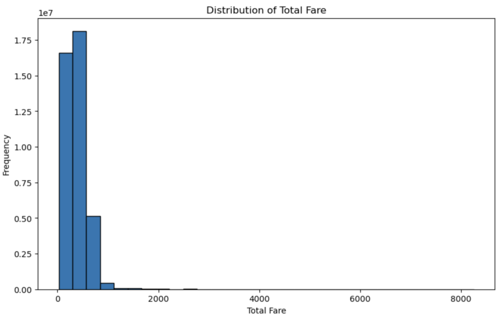
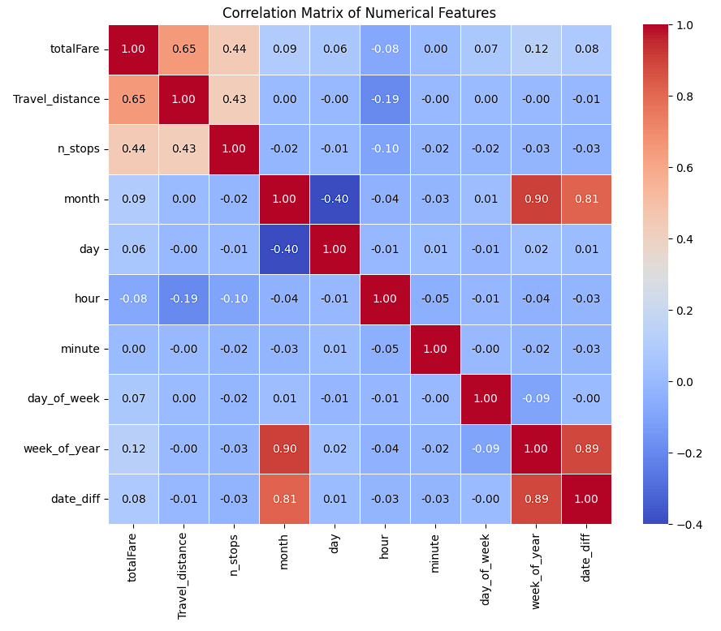
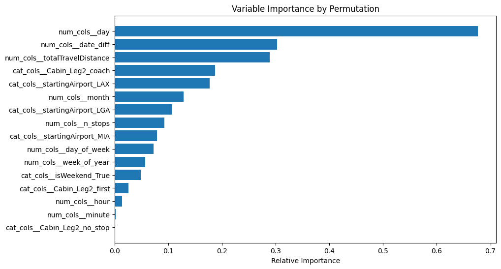
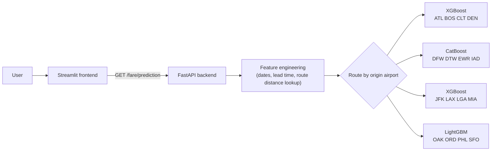

# Predicting US Domestic Airfares: Project Report

*A condensed version of the original 47-page group submission ([Report.pdf](Report.pdf)). It keeps the decisions, the results and the reasons behind them, and merges the four separate experiment logs into one story.*

**Contents:** [1. Summary](#1-summary) · [2. Problem](#2-problem) · [3. Data](#3-data) · [4. Preparation & features](#4-data-preparation--feature-engineering) · [5. Modelling](#5-modelling) · [6. Results](#6-results) · [7. Deployment](#7-deployment) · [8. Limitations](#8-limitations--next-steps) · [9. Privacy & ethics](#9-data-privacy--ethics) · [10. Team](#10-team)

---

## 1. Summary

| | |
|---|---|
| **Goal** | Predict the total fare of a US domestic flight from details a traveller knows when searching |
| **Data** | About 40M Expedia search records, 16 origin and 16 destination airports, 23 raw features |
| **Best models** | Gradient-boosted trees: XGBoost, CatBoost and LightGBM |
| **Accuracy** | Test RMSE of **$86–$100**, against $191–$204 for a baseline that always predicts the mean |
| **Deployment** | FastAPI backend and Streamlit frontend, Dockerised and hosted on Render ([live demo](https://at3-app-frontend-latest.onrender.com/)) |

A typical prediction is off by about $85–90. The median fare is $345, so this error is roughly 25% of a median ticket. That is accurate enough to show whether a trip will be cheap or expensive and how price responds to the trip details. It is not accurate enough to quote an exact price.

## 2. Problem

Travellers can't easily tell whether a fare is reasonable before they book. The product lets a user enter a trip and get an estimated price back. The inputs are:

- Origin and destination airport
- Departure date and time
- Number of stops
- Cabin class of each leg

The same predictions are useful for:

- **Pricing and route analysis:** comparing revenue potential and price sensitivity across routes
- **Customer insight:** understanding how fares respond to booking lead time, cabin class and distance

**Success metric:** RMSE in dollars. It is easy to read in business terms and penalises large misses. The secondary aim was to keep the gap between training and validation RMSE small, as a check on overfitting.

## 3. Data

The data is US domestic flight search results scraped from Expedia. Each row is one itinerary returned by a search.

- **Target:** `totalFare`, in USD including taxes. It ranges from $239 to $8,260, with a median of about $345.
- **Skew:** fares are strongly right-skewed. Most tickets are economy, and a long tail comes from business and first-class fares.
- **Basic economy:** only about 5.6% of itineraries are basic economy.
- **Travel distance:** two clusters, at 800–1,300 miles and 2,200–2,400 miles. The second cluster is cross-country routes.

**Strongest relationships with fare:** travel distance (r ≈ 0.65) and number of stops (r ≈ 0.44). Calendar features have weak linear correlation on their own, but tree models use them well when combined with other features.

## 4. Data preparation & feature engineering

The team split the work by origin airport, four airports each, and applied these shared steps:

| Step | What was done | Why |
|---|---|---|
| **Deduplication** | Removed duplicate searches, which were more than 60% of rows | The same itinerary searched many times would over-weight popular routes and leak between splits |
| **Missing distance** | Filled the roughly 5% of missing `totalTravelDistance` values with the median distance for each origin–destination pair | Keeps rows while giving a realistic distance |
| **Date features** | Built `month`, `day`, `day_of_week`, `week_of_year`, `hour` and `minute` from the departure time | Captures seasonality and time-of-day pricing |
| **Booking lead time** | `date_diff` = flight date − search date | Fares rise as departure approaches |
| **Itinerary shape** | `n_stops` and the cabin class of each leg (`Cabin_Leg1`–`4`, using `no_stop` for unused legs) | Stops and cabin are both strong price drivers |
| **Route distance lookup** | A table of median distance for each route (`median_traveldistance.csv`) | A user doesn't know the exact distance, so the deployed app looks it up from origin and destination |
| **Dropped features** | `legId`, `isRefundable` (almost always false), arrival-time bins and flight duration | Privacy, no useful signal, or not known to a user at search time (duration includes unknown layovers) |

**Preprocessing pipeline:** a scikit-learn `ColumnTransformer` handled encoding and scaling.

- Cabin class was ordinal-encoded (coach < premium coach < business < first), because price rises in that order.
- Airports were one-hot or target-encoded.
- Numeric features were standard-scaled.

Bundling preprocessing and model in one pipeline means the deployed app applies exactly the same transforms as training.

**Splits:** each segment was split 70/15/15 or 60/20/20 into train, validation and test sets. One segment split chronologically by search date, which mimics predicting future fares.

**Outliers:** the members handled them differently.

- Some kept them, because extreme fares are real behaviour, such as last-minute bookings.
- Others removed or clipped them, which helped reduce overfitting for CatBoost.

## 5. Modelling

Every segment followed the same progression: baseline, then linear models, then tree ensembles. The table below combines all four members' experiments into one view.

| Model family | Algorithms tried | Validation RMSE (range across segments) | Takeaway |
|---|---|---|---|
| Baseline | Dummy regressor (predicts mean) | $191–$204 | The bar to beat |
| Linear | Linear, Ridge, Lasso, ElasticNet, SGD | $136–$174 | Regularisation made no difference. The relationship is non-linear. |
| Distance-based | KNN | did not finish | Too slow on millions of rows with high-dimensional one-hot features |
| Single trees / bagging | Decision Tree, Random Forest, Extra Trees | $87–$98 | Big gains over linear models, so interactions matter. Extra Trees was close to the best but slow to train. |
| Boosting | AdaBoost | $158 | Sensitive to the retained outliers |
| Gradient boosting | **XGBoost, LightGBM, CatBoost** | **$86–$93** | The best accuracy-to-overfitting trade-off. Selected for deployment. |

Hyperparameters were tuned with randomised search (XGBoost and LightGBM) or Optuna (CatBoost). Where a more complex setting cut training error but widened the gap to validation error, the team chose the less overfit model. For example, a LightGBM run with a training RMSE of $69.56 was rejected in favour of a run with a smaller train–validation gap.

## 6. Results

The best model for each segment, on its held-out test set:

| Origin airports | Model | Train RMSE | Validation RMSE | **Test RMSE** |
|---|---|---|---|---|
| ATL, BOS, CLT, DEN | XGBoost | $85.38 | $85.91 | **$86.22** |
| DFW, DTW, EWR, IAD | CatBoost | $77.62 | $92.61 | **$87.72** |
| JFK, LAX, LGA, MIA | XGBoost | $89.12 | $91.53 | **$90.75** |
| OAK, ORD, PHL, SFO | LightGBM | $82.55 | $88.91 | **$100.44** |

**Reading these results:**

- **Similar error everywhere.** Four people used different algorithms and preprocessing on different airports, and all reached about $85–100. That suggests this is close to the limit of what these features can explain, not a weakness of one model.
- **Consistent splits.** The ATL/BOS/CLT/DEN XGBoost model has almost the same error on train, validation and test, so it generalises well.
- **Different airports.** The segments contain different airports, so the RMSE values compare segments, not algorithms head to head.

**What drives the price:** permutation importance for the JFK/LAX/LGA/MIA XGBoost model ranks the day of the month, booking lead time (`date_diff`) and travel distance highest. Cabin class and origin airport come next.

The models behave the way you'd expect:

- Fares rise with cabin class.
- Fares rise with distance.
- Fares rise as the flight date gets closer.

## 7. Deployment

- **Models:** each segment's model is serialised as a complete pipeline (`.joblib`, `.cbm` or `.pkl`) so preprocessing travels with it.
- **Backend:** FastAPI rebuilds the model features from the raw inputs and routes each request to the model for its origin airport.
- **Frontend:** Streamlit collects the trip details and calls the backend.
- **Infrastructure:** the backend and frontend have separate Docker images, pushed to Docker Hub and deployed as two Render services.

Code: [flight_fare_app](https://github.com/RatanaSovann/flight_fare_app).

**Known deployment gaps:** there is no monitoring of live prediction drift and no automated retraining. The free hosting tier also has cold starts and limited capacity.

## 8. Limitations & next steps

| Limitation | Next step |
|---|---|
| No seasonality signal (holidays, peak and off-peak periods) | Add a holiday calendar and peak-period flags |
| Distance comes from a median for each route, not the actual itinerary | Look up the actual route or duration through a flight API |
| The app lets users pick stop counts that don't exist on a route | Limit the stop options to routes that are actually flown |
| Four separate models, each with different preprocessing | Train one model on all airports with a shared pipeline. This is simpler to maintain and lets routes share information. |
| Point estimates only | Add prediction intervals, and a "buy now or wait" recommendation based on how price changes with lead time |

## 9. Data privacy & ethics

- **Privacy:** `legId` uniquely identifies itineraries and could be linked to other datasets, so it was dropped before training. Intermediate leg details were also left out of the model inputs.
- **Consent:** the data was scraped, so it is not known whether the original users consented. A production system would need clear consent, retention and access policies.
- **Bias:** fares on routes or cabins with less data, such as premium cabins and rarer routes, are predicted less accurately. Using one model per segment with a clear routing rule makes each prediction traceable to a specific model.

## 10. Team

This was a group project for *36120 Advanced Machine Learning Application*, Master of Data Science and Innovation, University of Technology Sydney, November 2024. The team used CRISP-DM with an agile cadence: weekly syncs, an early end-to-end deployment, then iterative model improvement.

| Member | Segment & model | Other contributions |
|---|---|---|
| **Ratana Sovann** | ATL/BOS/CLT/DEN: XGBoost | Integrated all four models into the FastAPI backend and Streamlit frontend, built the Docker images, deployed on Render |
| Farhan Faiyaz | OAK/ORD/PHL/SFO: LightGBM | Set up the shared research repo, route-distance feature |
| Yee Ting Li | JFK/LAX/LGA/MIA: XGBoost | Data extraction scripts, early backend and frontend prototype, report formatting |
| Md Sadman Sakib | DFW/DTW/EWR/IAD: CatBoost | Backend model integration |
